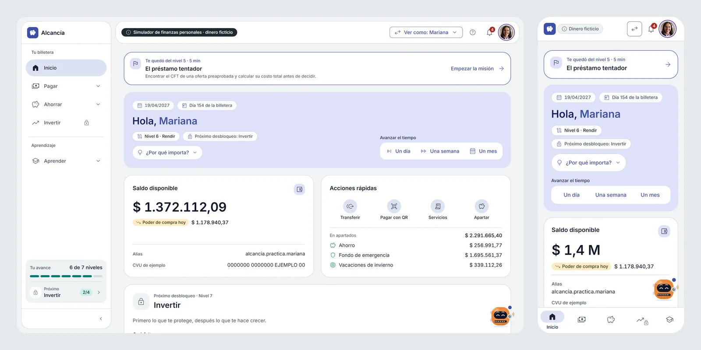
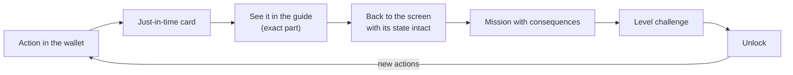
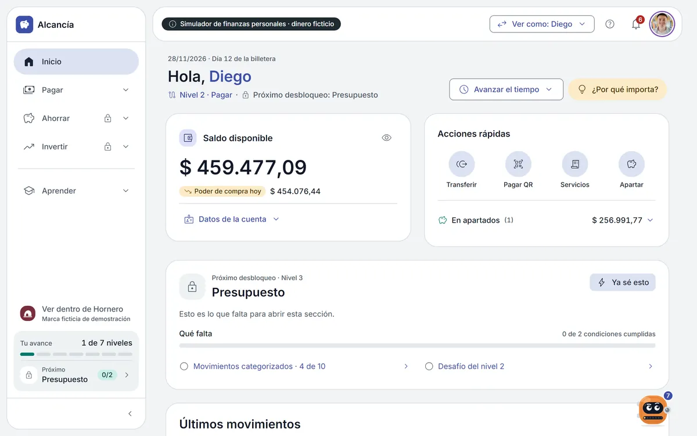
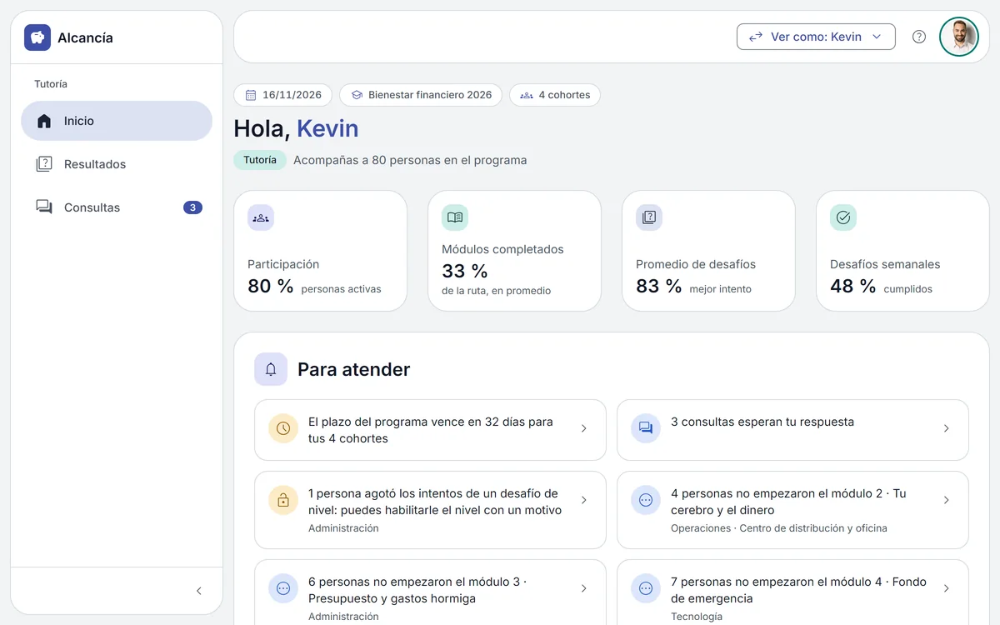
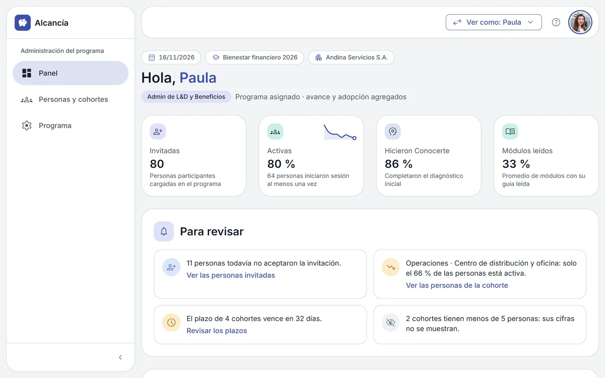
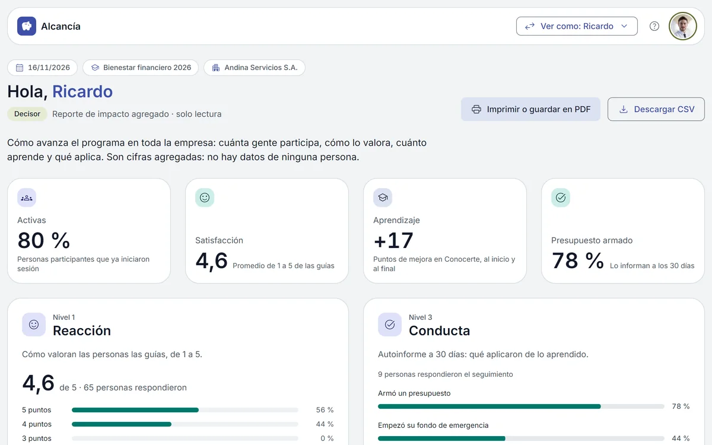
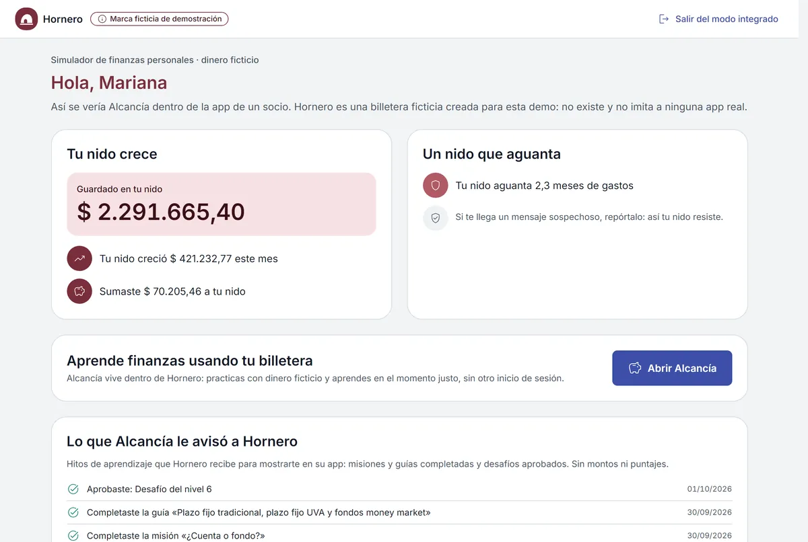
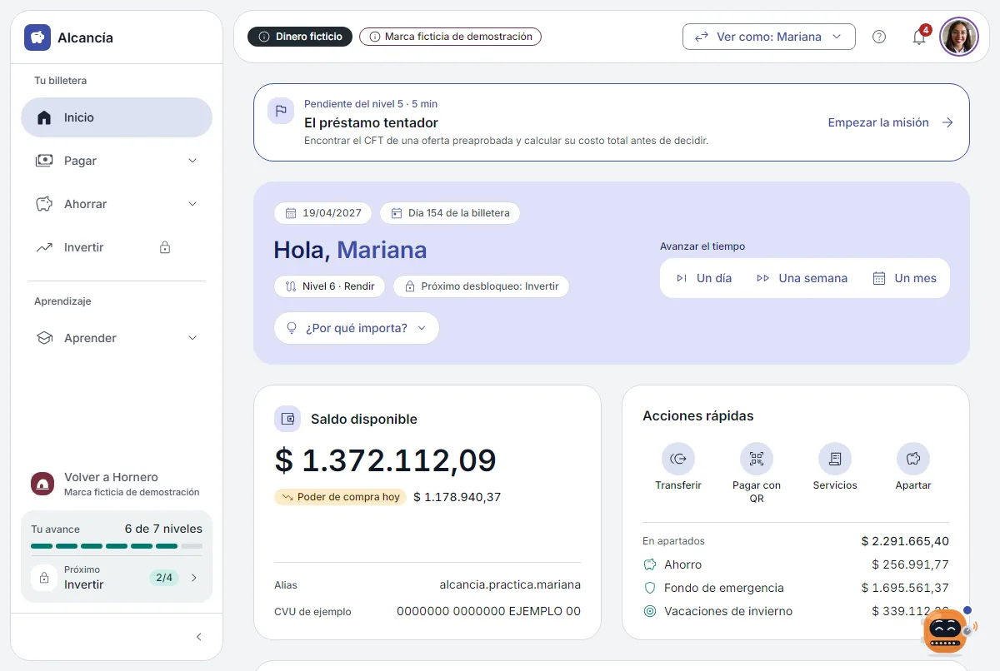

  

<h1 align="center">Alcancía</h1>

  A personal finance simulator where people learn by using a virtual wallet with fictitious money, 
  for organizations, classrooms and products.

  
  
  
  
  
  
  
  

  <a href="https://lpedaci.github.io/alcancia-app/"><strong>Demo</strong></a> ·
  <a href="https://lpedaci.github.io/alcancia-app/#/login?demo=mariana"><strong>Sign in as Mariana</strong></a> ·
  <a href="docs/README.md">Documentation (Spanish)</a> ·
  <a href="CLAUDE.md">Specification (Spanish)</a> ·
  <a href="README.md">Español</a>

> [!IMPORTANT]
> **Educational content. Not financial advice or an investment recommendation.** All money in the app is fictitious, and the people, entities and merchants in the demo are made up.

> [!NOTE]
> The app interface is in Spanish (Argentina). The landing page is also available in English; the rest of the app will be translated in phase B.

  

## What it is and what problem it solves

Many people learn about money after making mistakes with real money: paying the card minimum, taking a loan because the installment looks small, or leaving their salary idle while inflation eats it. Alcancía lets people make those mistakes earlier and for free. Learners do not enter a course: they enter their wallet. They get a practice salary, pay, budget, save, put their balance to work, decide about credit and invest. Each action teaches something at the moment it happens.

The same wallet works in three contexts: an **organization** offering it to its people as a benefit and training, a **higher education institution** for students aged 18 or over, and an **existing product**, such as a wallet or finance app, that embeds it for its users.

What sets it apart: **simulated time** (advance a day, a week or a month to see yields, installments and inflation); sections **unlock through financial behavior**, not clicks (Invest opens with an emergency fund and no expensive debt); decisions **leave a mark** on the wallet (a loan shows up in your debts and blocks investing until it is paid); the content is **Argentine** and grounded in official sources (BCRA, CNV, INDEC); and the organization **never sees anyone's finances**, only aggregated learning progress.

## How people learn

Learning starts from action. The person does something in the wallet, gets a short explanation right when they need it, can jump to the exact part of the guide that explains it, and returns to the same screen without losing anything. Then they practice it in a mission with consequences and prove it in the level challenge, which unlocks the next section.

The cycle follows Kolb's (1984) experiential learning: concrete experience (the action), reflective observation (the card and its question), conceptualization (the guide) and active experimentation (the mission). The card appears at the moment of need (Gottfredson & Mosher, 2011), which suits adults with little time (Knowles et al., 2015).

| Level | Section | What people learn | Opens with |
| --- | --- | --- | --- |
| 0 | Open your account | Welcome, diagnostic and basic security | First sign-in |
| 1 | Account | Payslip; your brain and money | Finishing level 0 |
| 2 | Pay | Wallets and fintech, transfers and QR; scams | Mission 1 and the level 1 challenge |
| 3 | Budget | Budget and small recurring expenses | 10 categorized movements and the level 2 challenge |
| 4 | Pockets and goals | Emergency fund | A month closed in the green and the level 3 challenge |
| 5 | Card and loans | Debt order, credit card and total financial cost, getting out of debt, installments or cash | The level 4 challenge |
| 6 | Yield | Inflation, rates (nominal, effective, real), term deposits, inflation-indexed deposits and money market funds | Emergency fund created and the level 5 challenge |
| 7 | Invest | Saving vs. investing, investor profile and broker, capital markets, CEDEARs | **Four conditions:** an emergency fund of at least 3 months of expenses, no high-rate debt, the level 6 challenge and the investor profile test |

There are nine assessment types, each with feedback per option, including a **case with decisions** where each choice leads to a consequence. Impact is measured with Kirkpatrick levels 1 to 3.

## Role walkthroughs

<table>
  <tr>
    <td width="50%" valign="top">
      
      <h3>Participant</h3>
      
Uses the wallet. Diego starts at level 2 on his phone; Mariana is at level 6.

      
<a href="https://lpedaci.github.io/alcancia-app/#/login?demo=diego">Sign in as Diego</a> · <a href="https://lpedaci.github.io/alcancia-app/#/login?demo=mariana">Sign in as Mariana</a>

    </td>
    <td width="50%" valign="top">
      
      <h3>Tutor</h3>
      
Supports cohorts with learning progress, most-missed questions and inquiries. Never sees amounts.

      
<a href="https://lpedaci.github.io/alcancia-app/#/login?demo=kevin">Sign in as Kevin</a>

    </td>
  </tr>
  <tr>
    <td width="50%" valign="top">
      
      <h3>L&D and Benefits admin</h3>
      
Sets up the program, imports people from CSV with row-by-row validation and follows adoption in aggregate.

      
<a href="https://lpedaci.github.io/alcancia-app/#/login?demo=julieta">Sign in as Julieta</a>

    </td>
    <td width="50%" valign="top">
      
      <h3>Sponsor</h3>
      
Reads the read-only, exportable impact report, with no individual data.

      
<a href="https://lpedaci.github.io/alcancia-app/#/login?demo=ricardo">Sign in as Ricardo</a>

    </td>
  </tr>
</table>

## Three contexts and the integrated mode

The same wallet works for **teams, classrooms and products**: an organization offers it to its people (Andina Servicios S.A. in the demo), a higher-education institution to its students aged 18 or over (Instituto Superior Ceibo), or a finance app integrates it for its users (Hornero). The wallet, levels, missions and privacy stay the same; role names, how people come in and which panels exist change. In the demo, "View as" asks for the context first and then the person, and each panel only sees its own organization's data.

The **integrated mode** is shown with **Hornero**, a fictitious wallet made for the demo, with its own brand and the label "Fictitious demo brand" (it does not refer to any real brand). Hornero shows the person's savings through its brand idea: a nest that grows little by little and a nest that holds. Alcancía opens inside it with no second sign-in, and Hornero stays in the menu to go back. The partner only gets progress notices, never amounts.

<table>
  <tr>
    <td width="50%"></td>
    <td width="50%"></td>
  </tr>
</table>

## Accessibility

The target is **WCAG 2.2 AA**. Checked automatically on every change: no axe errors on 71 screens at 375 and 1280 px, no horizontal overflow at 6 widths (320 to 1440 px), one `h1` per screen, AA contrast for every color token pair, and "Why it matters" visible even with the companion muted. **Not verified yet:** a full screen reader walkthrough and a Lighthouse audit. Until then, the app does not claim conformance; it is the target.

## Sources, credits and authorship

Content is grounded in official Argentine sources: BCRA, CNV, INDEC, BYMA, Caja de Valores and argentina.gob.ar. **Rates and inflation in the scenario are example values**, not current ones.

Design and development: **Lourdes Pedaci, Experience Designer (Learning and UX/UI)**. Finance content is based on material by Lic. Kevin Giampieri for the workshop "Del aula al primer trabajo". Demo profile photos: "Designed by Magnific" ([magnific.com](https://www.magnific.com/)).

**License:** all rights reserved. The finance content belongs to its authors.

### References

Gottfredson, C., & Mosher, B. (2011). *Innovative performance support: Strategies and practices for learning in the workflow*. McGraw-Hill.

Kirkpatrick, J. D., & Kirkpatrick, W. K. (2016). *Kirkpatrick's four levels of training evaluation*. ATD Press.

Knowles, M. S., Holton, E. F., III, & Swanson, R. A. (2015). *The adult learner: The definitive classic in adult education and human resource development* (8th ed.). Routledge.

Kolb, D. A. (1984). *Experiential learning: Experience as the source of learning and development*. Prentice Hall.

World Wide Web Consortium. (2023). *Web Content Accessibility Guidelines (WCAG) 2.2*. https://www.w3.org/TR/WCAG22/
