<p align="center">
  
</p>

<h1 align="center">Alcancía</h1>

<p align="center">
  Un simulador de finanzas personales donde se aprende usando una billetera virtual con dinero ficticio,<br>
  para organizaciones, aulas y productos.
</p>

<p align="center">
  <a href="https://github.com/lpedaci/alcancia-app/actions/workflows/deploy.yml"></a>
  <a href="https://lpedaci.github.io/alcancia-app/"></a>
  
  
  
  
  
  
</p>

<p align="center">
  <a href="https://lpedaci.github.io/alcancia-app/"><strong>Demo</strong></a> ·
  <a href="https://lpedaci.github.io/alcancia-app/#/login?demo=mariana"><strong>Entrar como Mariana</strong></a> ·
  <a href="docs/README.md">Documentación</a> ·
  <a href="CLAUDE.md">Especificación</a> ·
  <a href="README.en.md">English</a>
</p>

> [!IMPORTANT]
> **Contenido educativo. No es asesoramiento financiero ni una recomendación de inversión.** Todo el dinero de la app es ficticio, y las personas, entidades y comercios de la demo son inventados.

<p align="center">
  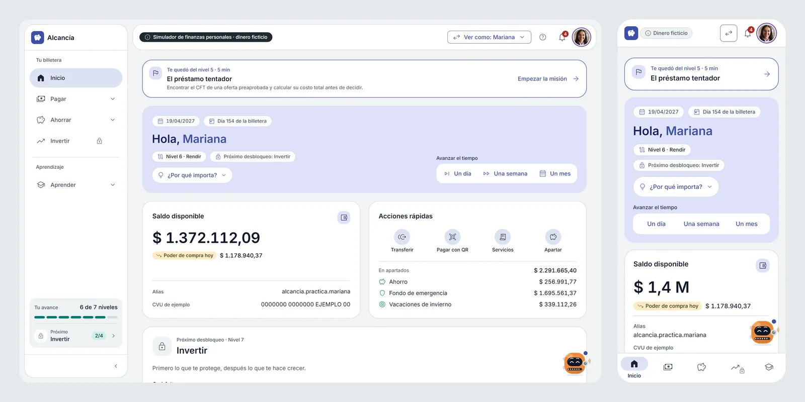
</p>

La app no tiene tema oscuro activo todavía: los tokens lo dejan preparado, pero falta verificar el contraste de cada combinación. Por eso las imágenes muestran solo el tema claro.

## Contenido

- [Qué es y qué problema resuelve](#qué-es-y-qué-problema-resuelve)
- [Cómo se aprende](#cómo-se-aprende)
- [Recorridos por rol](#recorridos-por-rol)
- [Diseño UX/UI](#diseño-uxui)
- [Accesibilidad](#accesibilidad)
- [Privacidad por diseño](#privacidad-por-diseño)
- [Para desarrolladores](#para-desarrolladores)
- [Estado y hoja de ruta](#estado-y-hoja-de-ruta)
- [Documentación](#documentación)
- [Fuentes, créditos y autoría](#fuentes-créditos-y-autoría)

## Qué es y qué problema resuelve

Muchas personas aprenden finanzas cuando ya se equivocaron con dinero real: pagan el mínimo de la tarjeta, aceptan un préstamo por la cuota o dejan el sueldo quieto mientras la inflación se lo come. Alcancía propone equivocarse antes y gratis. Quien aprende no entra a un curso: entra a su billetera, cobra un sueldo de práctica, paga, presupuesta, ahorra, hace rendir su saldo, decide sobre crédito e invierte. Cada acción enseña algo en el momento en que pasa.

La misma billetera sirve en tres contextos (D-74): una **organización** que la ofrece a su gente como beneficio y capacitación, una **institución educativa** de nivel superior para estudiantes de 18 años o más, y un **producto existente**, como una billetera o app financiera, que la integra para sus usuarios. Cambian el vocabulario, los roles visibles y la entrada; la billetera, los niveles y la privacidad son los mismos.

Qué la diferencia de un curso o de una calculadora: el **tiempo se simula** (avanzar un día, una semana o un mes muestra rendimientos, cuotas e inflación); las secciones se **desbloquean por conducta financiera**, no por clics (Invertir se abre con fondo de emergencia y sin deudas caras); las decisiones **dejan huella** en la billetera (un préstamo aparece en Tus deudas y bloquea Invertir hasta saldarlo); el contenido es **argentino** y se apoya en fuentes oficiales (BCRA, CNV, INDEC); y la organización **nunca ve la situación financiera** de nadie, solo avance de aprendizaje agregado.

## Cómo se aprende

El aprendizaje nace de la acción. La persona hace algo en la billetera, recibe una explicación corta justo cuando la necesita, puede ir a la parte exacta de la guía que lo explica y vuelve a la misma pantalla sin perder lo que estaba haciendo. Después lo practica en una misión con consecuencias y lo demuestra en el desafío del nivel, que abre la sección siguiente.

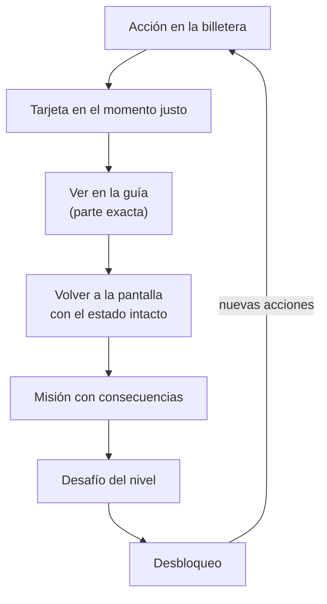

El ciclo sigue el aprendizaje experiencial de Kolb (1984): experiencia concreta (la acción), observación reflexiva (la tarjeta y su pregunta), conceptualización (la guía) y experimentación activa (la misión). La tarjeta aparece en el momento de la acción, no antes ni en un módulo aparte, como propone el aprendizaje en el momento de la necesidad (Gottfredson y Mosher, 2011). Para adultos con poco tiempo, eso respeta lo que ya saben y lo que necesitan resolver hoy (Knowles et al., 2015).

<table>
  <tr>
    <td width="33%">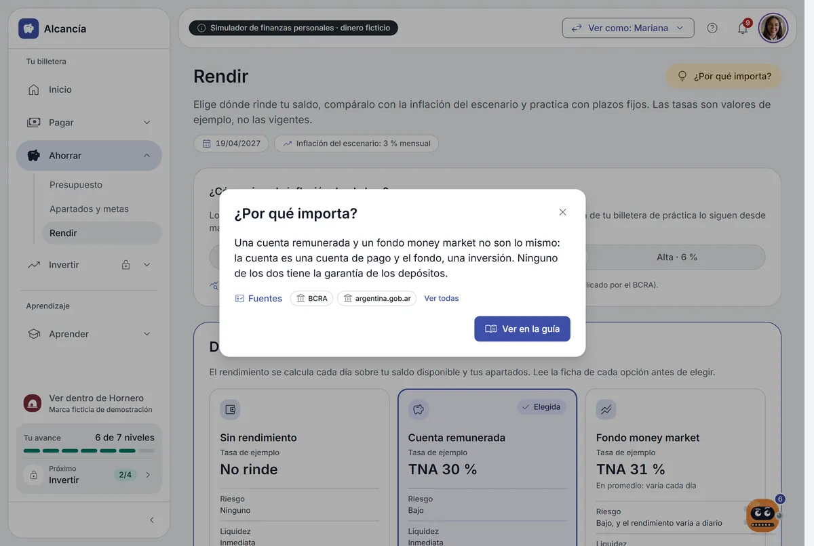</td>
    <td width="33%">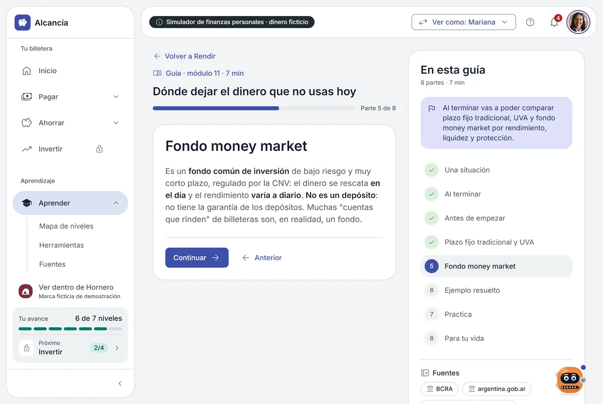</td>
    <td width="33%">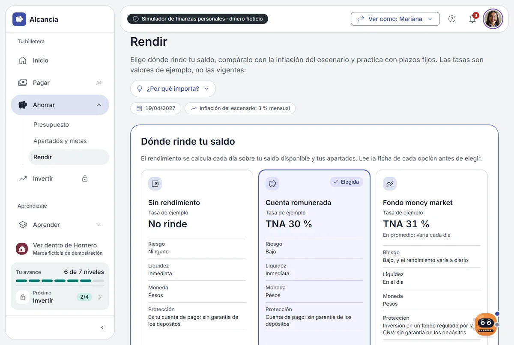</td>
  </tr>
  <tr>
    <td align="center">1. La explicación, en la pantalla</td>
    <td align="center">2. La parte exacta de la guía</td>
    <td align="center">3. De vuelta, sin perder nada</td>
  </tr>
</table>

### Niveles y desbloqueos

Lo bloqueado se ve, nunca se esconde: cada sección bloqueada dice qué falta y lleva a la acción que la acerca. Quien ya sabe puede hacer el desafío de suficiencia ("Ya sé esto") y saltar el nivel.

| Nivel | Sección | Qué se aprende | Se abre con |
| --- | --- | --- | --- |
| 0 | Abrir tu cuenta | Bienvenida, "Conocerte" (diagnóstico) y seguridad básica | El primer ingreso |
| 1 | Cuenta | Recibo de sueldo; tu cerebro y el dinero | Terminar el nivel 0 |
| 2 | Pagar | Billeteras y fintech, transferencias y QR; estafas | La misión 1 y el desafío del nivel 1 |
| 3 | Presupuesto | Presupuesto y gastos hormiga | 10 movimientos categorizados y el desafío del nivel 2 |
| 4 | Apartados y metas | Fondo de emergencia | Un mes cerrado en verde y el desafío del nivel 3 |
| 5 | Tarjeta y préstamos | El orden de las deudas, tarjeta y CFT, salir de deudas, cuotas o contado | El desafío del nivel 4 |
| 6 | Rendir | Inflación, tasas (TNA, TEA, tasa real), plazo fijo, UVA y money market | Fondo de emergencia creado y el desafío del nivel 5 |
| 7 | Invertir | Ahorrar e invertir, perfil de inversor y bróker, mercado de capitales, CEDEARs | **Cuatro condiciones:** fondo de emergencia de al menos 3 meses de gastos, sin deudas de tasa alta, el desafío del nivel 6 y el test de perfil de inversor |

El orden es el contenido: primero lo que te protege, después lo que te hace crecer.

### Evaluación e impacto

Cada pregunta tiene una devolución por opción que explica el porqué. Hay nueve tipos, elegidos por lo que se quiere comprobar: opción única, opción múltiple, verdadero o falso con justificación, respuesta numérica con tolerancia, ordenar pasos, unir pares, clasificar en categorías, ejercicio con una herramienta y **caso con decisiones**, donde cada elección lleva a una consecuencia y a la siguiente decisión. Todos los que se arrastran tienen una alternativa con botones o menús, y ninguno tiene límite de tiempo.

El impacto se mide con los niveles 1 a 3 de Kirkpatrick y Kirkpatrick (2016): satisfacción con cada guía, diferencia entre el diagnóstico inicial y el final (solo con las preguntas de conocimiento) y un autoinforme de conducta a 30 días. El nivel 4 queda como línea futura: no se inventan datos de negocio.

## Recorridos por rol

Cada enlace entra a la demo con esa persona. El acceso con SSO y verificación en dos pasos es simulado; el código de la demo ya viene cargado.

<table>
  <tr>
    <td width="50%" valign="top">
      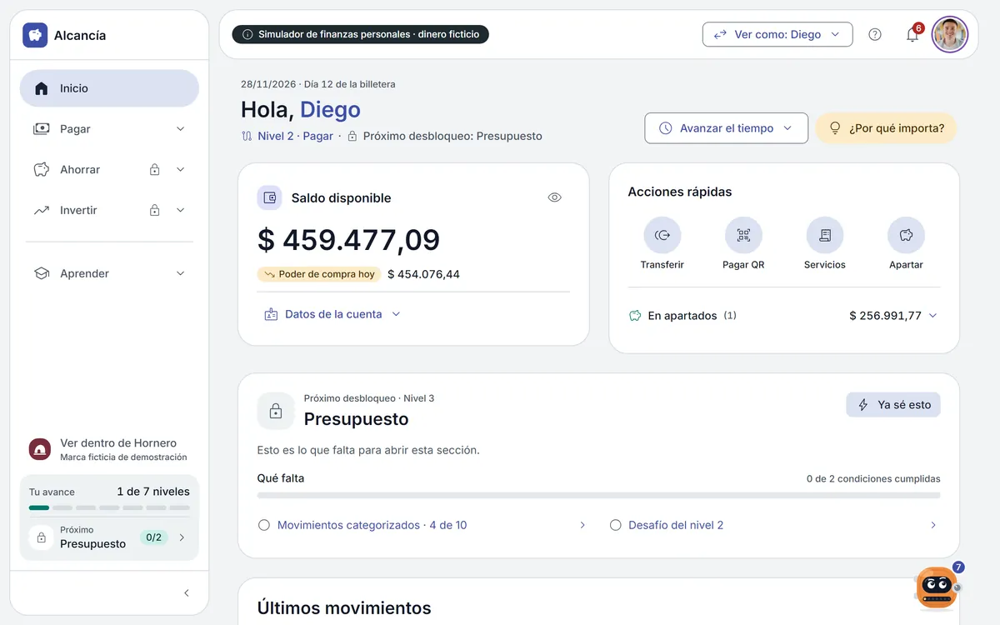
      <h3>Participante</h3>
      <p>Usa la billetera: cobra, paga, ahorra y decide. Diego empieza en el nivel 2, desde el celular; Mariana está en el nivel 6, con el fondo de emergencia a 2 de 3 meses.</p>
      <p><a href="https://lpedaci.github.io/alcancia-app/#/login?demo=diego">Entrar como Diego</a> · <a href="https://lpedaci.github.io/alcancia-app/#/login?demo=mariana">Entrar como Mariana</a></p>
    </td>
    <td width="50%" valign="top">
      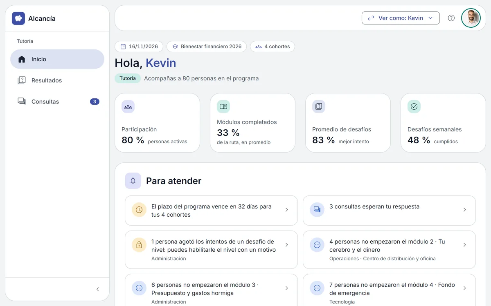
      <h3>Tutor</h3>
      <p>Acompaña a sus cohortes: ve el avance de aprendizaje, las preguntas con más errores y las consultas. Puede habilitar un nivel con un motivo. Nunca ve montos.</p>
      <p><a href="https://lpedaci.github.io/alcancia-app/#/login?demo=kevin">Entrar como Kevin</a></p>
    </td>
  </tr>
  <tr>
    <td width="50%" valign="top">
      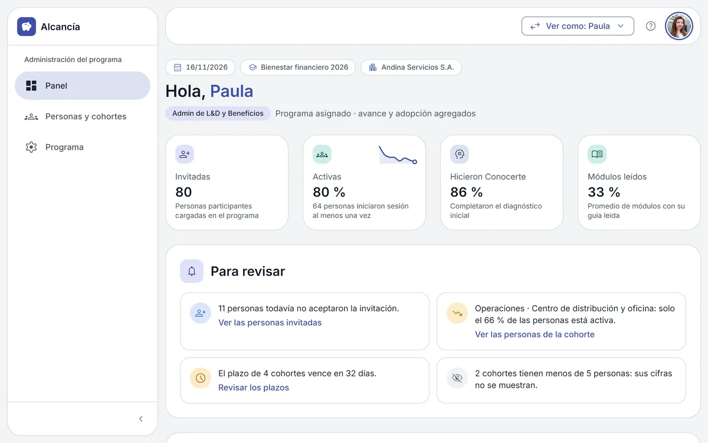
      <h3>Admin de L&D y Beneficios</h3>
      <p>Configura el programa, carga personas por CSV con validación fila por fila, arma cohortes y sigue la adopción en cifras agregadas.</p>
      <p><a href="https://lpedaci.github.io/alcancia-app/#/login?demo=paula">Entrar como Paula</a></p>
    </td>
    <td width="50%" valign="top">
      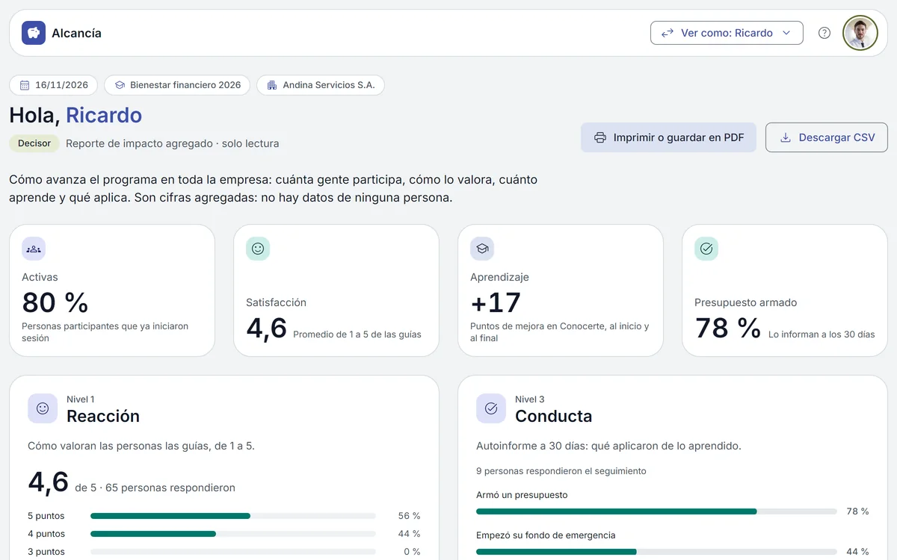
      <h3>Decisor</h3>
      <p>Lee el reporte de impacto, de solo lectura y exportable, con los niveles 1 a 3 de Kirkpatrick y sin datos individuales.</p>
      <p><a href="https://lpedaci.github.io/alcancia-app/#/login?demo=ricardo">Entrar como Ricardo</a></p>
    </td>
  </tr>
</table>

## Diseño UX/UI

El sistema de diseño parte de Material Design 3 con identidad propia: tokens en cuatro niveles (referencia, sistema, tema de Tailwind y componentes con variantes), paleta fría de índigo y verde azulado, tipografía Inter con la escala de M3, profundidad por elevación tonal y sin sombras en tarjetas en reposo. El contraste AA de cada combinación de tokens se verifica con tests. Todo está documentado en la página pública del [sistema de diseño](https://lpedaci.github.io/alcancia-app/#/design-system), con componentes reales y la sección "Cómo mostramos el dinero".

Algunas piezas propias: `OptionCard` para comparar opciones antes de elegir, con la misma ficha en todas y la elegida marcada con borde y texto, no solo con color; los campos de dinero con máscara; y **Fuerte**, el compañero de la billetera, que reacciona a lo que pasa y tiene tres niveles de presencia (conversador, solo lo importante y silencio). Su naranja es la única excepción a la paleta fría.

<p align="center">
  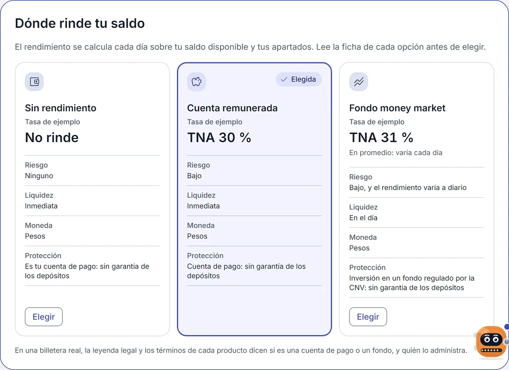
</p>

### Responsive

Cada pantalla se prueba en **320, 375, 768, 1024, 1280 y 1440 px**. En celular y tablet, la navegación es una barra inferior con cinco destinos; desde 1200 px, un menú lateral con subsecciones. Los montos nunca se cortan: si no entran, bajan un rol tipográfico o se abrevian con el valor completo accesible.

<p align="center">
  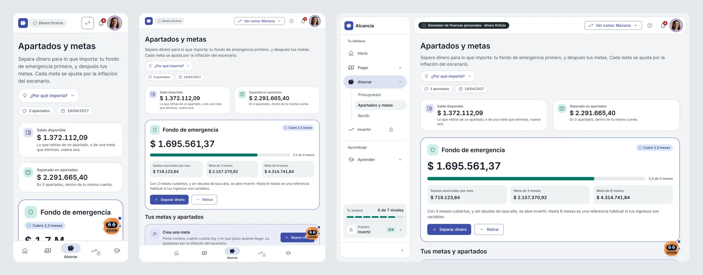
</p>

### Decisiones de UX clave

- **"¿Por qué importa?" en cada pantalla de la billetera**, visible aunque Fuerte esté en silencio.
- **Nada se pierde al ir a la guía:** el enlace lleva a la parte exacta y "Volver" recupera la pantalla, el desplazamiento y lo que estaba escrito.
- **Errores con red:** equivocarse está permitido, deja su huella en la billetera y siempre termina en una devolución que explica qué pasó y cómo revertirlo dentro de la simulación.
- **Lo bloqueado se ve:** cada sección cerrada dice qué falta, con progreso.
- **Gamificación con medida:** logros por conductas sanas, sin rankings, rachas que castigan ni cuentas regresivas.
- **Ganancias y pérdidas con signo, ícono y texto**, nunca solo verde y rojo; perder poder de compra es información, no un error.

## Accesibilidad

El objetivo es **WCAG 2.2 AA**. Lo que se verifica automáticamente en cada cambio:

- axe sin errores en 71 pantallas, en 375 y 1280 px.
- Sin desbordes horizontales, textos aplastados ni botones fuera de su tarjeta en los 6 anchos.
- Un solo `h1` por pantalla.
- Contraste AA de cada combinación de tokens de color.
- "¿Por qué importa?" visible con Fuerte en silencio, y regiones en vivo para los cambios de saldo y resultados.

Lo que **todavía no se verificó** y queda pendiente: el recorrido completo con lector de pantalla (NVDA y VoiceOver) en el diagnóstico, una guía y una herramienta, y la auditoría con Lighthouse. Hasta hacerlo, la app no declara que cumple WCAG 2.2 AA: es su objetivo.

Este README también busca ser accesible: cada imagen tiene un texto alternativo que describe lo que muestra, los diagramas tienen título y descripción (`accTitle` y `accDescr`) y nada depende solo del color.

## Privacidad por diseño

Los montos y decisiones de la billetera viven solo en el navegador de la persona. La organización ve avance de aprendizaje, y siempre en grupos de 5 personas o más.

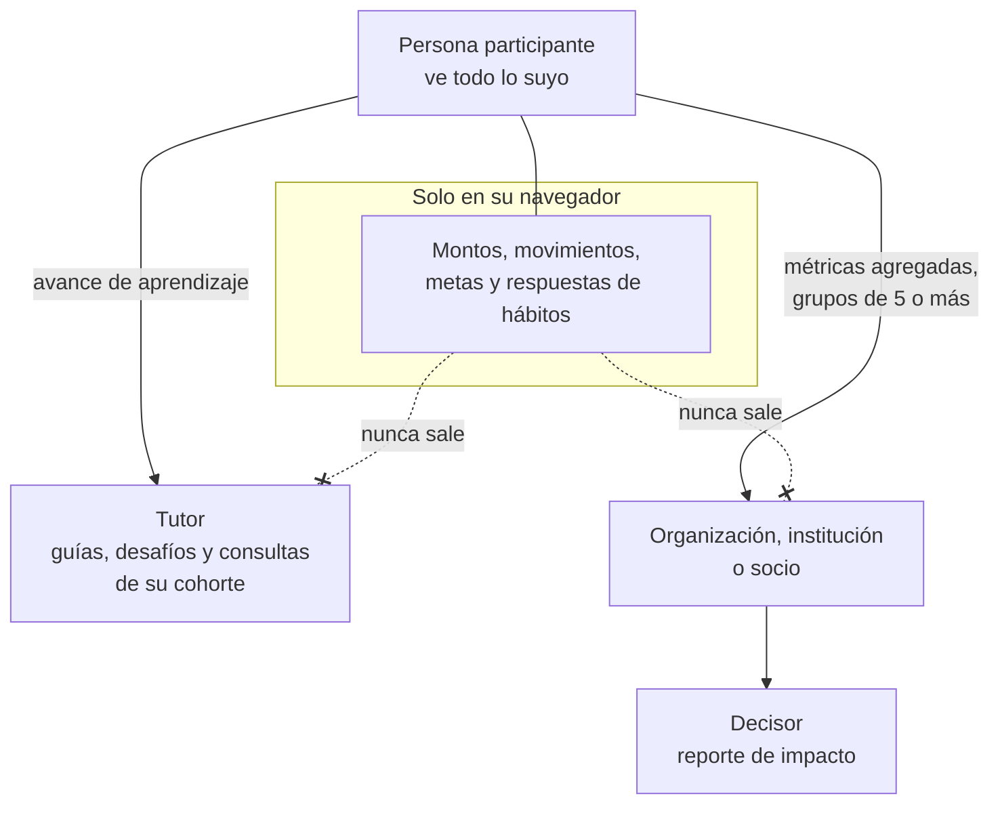

El tutor tampoco ve si un nivel está bloqueado, porque de ahí se deduciría una condición de la billetera (D-58). Tests de `privacy-boundaries` comprueban que ninguna vista de otro rol lee los datos locales de la persona.

## Para desarrolladores

**No hay backend.** Es una app React estática: los datos semilla están en JSON, el estado se guarda en `localStorage` y el sitio se publica en GitHub Pages.

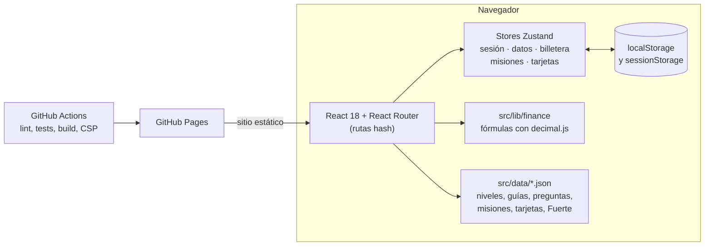

Así se encadena una acción con consecuencia, por ejemplo tomar un préstamo:

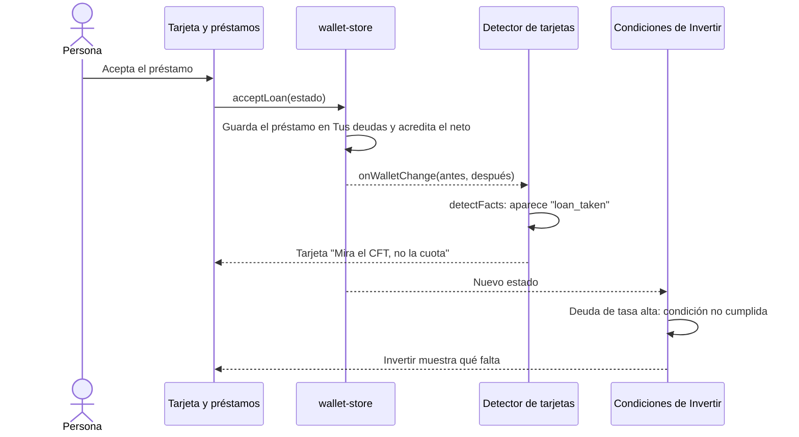

### Dónde está cada cosa

```text
src/
  app/            Router, layout, fuentes oficiales (sources.ts) y configuración
  components/     ui/ (botones, OptionCard, diálogos...), money/ (MoneyInput, MoneyText), charts/
  features/
    wallet/       La billetera y su motor económico (engine/)
    levels/       Niveles, desbloqueos y "Ya sé esto"
    missions/     Motor de misiones declarativo
    learning/     Mapa de niveles, guías, desafíos y preguntas
    learning-cards/  Tarjetas en el momento justo y "¿Por qué importa?"
    companion/    Fuerte y sus niveles de presencia
    pay/ budget/ pockets/ yield/ credit/ invest/   Secciones de la billetera
    simulators/   Herramientas SIM-1 a SIM-12
    tutor/ organization/ sponsor/   Paneles de los otros roles
    design-system/   Página pública del sistema de diseño
  lib/
    finance/      Fórmulas puras con decimal.js y sus tests
    metrics.ts    Métricas agregadas con umbral de privacidad
    permissions.ts   Permisos por rol
  data/           Contenido declarativo en JSON
  store/          Stores persistidos (sesión, datos, billetera)
  locales/        Textos en español e inglés (i18next)
  styles/         Tokens y utilidades
e2e/              Pruebas de Playwright (desbordes, axe, seguridad en producción)
docs/             Documentación del proyecto
```

### Cómo correrlo

Requiere Node 22 o superior.

```bash
npm install
```

```bash
npm run dev
```

| Script | Qué hace |
| --- | --- |
| `npm run dev` | Servidor de desarrollo con Vite |
| `npm run build` | Chequeo de tipos y build de producción, con la CSP inyectada |
| `npm run preview` | Sirve el build de producción |
| `npm run typecheck` | Solo el chequeo de tipos |
| `npm run lint` | ESLint |
| `npm test` | Tests unitarios con Vitest |
| `npm run test:watch` | Vitest en modo observador |
| `npm run test:e2e` | Playwright contra el servidor de desarrollo: desbordes en 6 anchos y axe |
| `npm run test:e2e:prod` | Build de producción y Playwright con la CSP activa |
| `npm run icons` | Regenera los íconos SVG de Material Symbols que usa la app |
| `npm run seed` | Regenera los datos semilla de la demo |
| `npm run og-image` | Regenera la imagen para redes (con `npm run dev` corriendo) |
| `npm run market` | Prueba local de valores reales del BCRA (fase B; no lo usa la interfaz todavía) |

### Agregar contenido sin tocar código

El equipo de L&D puede sumar contenido editando JSON. Tres ejemplos cortos:

Una tarjeta en el momento justo, en `src/data/learning-cards.json`:

```json
{
  "id": "card-salary-save-first",
  "trigger": "salary_received",
  "condition": "no_saving_since_last_salary",
  "title": "Primero separa, después gastas",
  "body": "Si apartas una parte apenas cobras, el ahorro no depende de lo que sobre a fin de mes.",
  "sourceIds": ["A-32"],
  "guide": { "guideId": "module-03-guide-1", "part": 4 }
}
```

Una pregunta en `src/data/question-banks.json`:

```json
{
  "id": "m01-gross",
  "moduleId": "module-01",
  "type": "single",
  "prompt": "¿Qué es el sueldo bruto?",
  "options": [
    { "id": "a", "text": "El total antes de restar los descuentos" },
    { "id": "b", "text": "Lo que entra en tu cuenta" }
  ],
  "correctOptionIds": ["a"],
  "feedback": {
    "a": "Correcto. El bruto es el total antes de los descuentos.",
    "b": "Eso es el neto: lo que queda después de los descuentos."
  },
  "sourceIds": ["T"]
}
```

Una frase de Fuerte en `src/data/fuerte-lines.json`:

```json
"budget.fuerte.green": {
  "state": "celebration",
  "variants": ["Guardado. Este mes viene en verde."]
}
```

### Calidad

| Suite | Qué cubre | Al 14/11/2026 |
| --- | --- | --- |
| Vitest | Fórmulas financieras con casos calculados a mano, motor de la billetera y de misiones, desbloqueos, tarjetas, umbral de privacidad, permisos, máscaras de dinero, contraste de tokens | 599 tests |
| Playwright (desarrollo) | Desbordes en 6 anchos, axe en 2 anchos, un `h1` por pantalla | 641 tests |
| Playwright (producción) | El build real con la CSP activa, sin errores de consola | 72 tests |

La CI corre lint, tipos, tests unitarios, `npm audit` y las pruebas de producción antes de publicar. Un hook de `pre-push` repite lint, tipos y tests unitarios en local.

**Seguridad del front:** Content Security Policy con `script-src 'self'`, sin `dangerouslySetInnerHTML`, enlaces externos con `noopener noreferrer`, validación con Zod, dependencias con versión fija y solo datos de demo en el almacenamiento local. GitHub Pages no permite encabezados HTTP propios; el detalle, los límites y la mejora futura están en [docs/security.md](docs/security.md).

## Estado y hoja de ruta

- **Fase A, completa:** acceso simulado, la billetera con sus 8 niveles (0 a 7), 13 misiones, 16 módulos con su guía, 12 herramientas, la cuenta comitente de práctica y los paneles del tutor, el admin y el decisor.
- **Ajuste de fase A, en curso:** tarjetas en el momento justo también en el modo libre, la guía que nace de la acción, consecuencias en la billetera, casos con decisiones en los desafíos y la investigación de valores reales del mercado.
- **Fase B, próxima:** valores reales con fecha y fuente (tasas, UVA, CER, tipo de cambio, inflación), los tres contextos de uso, el modo integrado en un producto, repaso espaciado y recordatorios, meta colectiva por cohorte, las guías 2 y 3 de cada módulo, cripto, el escape room "Tu primer sueldo", certificados y el inglés completo.
- **Una posible fase C:** un backend con SSO real, roles en el servidor y datos cifrados, si el prototipo pasa a piloto. Sin fecha.

## Documentación

| Documento | Para qué sirve |
| --- | --- |
| [docs/README.md](docs/README.md) | Índice de la documentación |
| [personas.md](docs/personas.md) | Proto-personas por rol, como hipótesis sin validar |
| [roles.md](docs/roles.md) | Roles, matriz de permisos y qué datos ve cada uno |
| [requirements.md](docs/requirements.md) | Requerimientos funcionales y no funcionales con su estado |
| [use-cases.md](docs/use-cases.md) | Casos de uso principales |
| [flows.md](docs/flows.md) | Flujos de tareas y de usuario, y diagramas de estados |
| [information-architecture.md](docs/information-architecture.md) | Inventario, organización, rotulado y navegación |
| [design-system.md](docs/design-system.md) | Versión en Markdown del sistema de diseño |
| [learning-design.md](docs/learning-design.md) | Público, resultados de aprendizaje, secuencia y evaluación |
| [content.md](docs/content.md) | Objetivo, evidencia y fuentes de cada módulo |
| [formulas.md](docs/formulas.md) | Cada fórmula con sus supuestos y casos calculados a mano |
| [wallet-engine.md](docs/wallet-engine.md) | Reglas de la economía simulada y sus consecuencias |
| [market-data.md](docs/market-data.md) | Valores reales del mercado: fuentes, identificadores y qué pasa si fallan |
| [security.md](docs/security.md) | Seguridad y privacidad: capas, límites y producción |
| [visual-audit.md](docs/visual-audit.md) | Referencias visuales y qué se tomó de cada una |
| [review-fase-a.md](docs/review-fase-a.md) | Revisión de la fase A y de su ajuste |
| [decisions.md](docs/decisions.md) | Registro de decisiones |
| [progress.md](docs/progress.md) | Avance paso a paso |
| [issues.md](docs/issues.md) | Incidencias |
| [questions.md](docs/questions.md) | Dudas de contenido y datos pendientes de verificar |

## Fuentes, créditos y autoría

**Fuentes oficiales del contenido:** Banco Central de la República Argentina (BCRA), Comisión Nacional de Valores (CNV), Instituto Nacional de Estadística y Censos (INDEC), Bolsas y Mercados Argentinos (BYMA), Caja de Valores y argentina.gob.ar. Cada dato se muestra con su fuente y su fecha de verificación. **Las tasas y la inflación del escenario son valores de ejemplo**, no las vigentes; los precios de acciones y CEDEARs también son de ejemplo.

**Autoría:** Diseño y desarrollo: **Lourdes Pedaci, Experience Designer (Learning y UX/UI)**. El contenido de finanzas se basa en el material del Lic. Kevin Giampieri para el taller "Del aula al primer trabajo"; lo que Alcancía amplía queda marcado como pendiente de su revisión en [content.md](docs/content.md).

**Imágenes:** las fotos de las personas de la demo son de stock, "Designed by Magnific" ([magnific.com](https://www.magnific.com/)), con su licencia gratuita.

**Licencia:** todos los derechos reservados. El contenido de finanzas pertenece a sus autores.

### Referencias

Anderson, L. W., & Krathwohl, D. R. (Eds.). (2001). *A taxonomy for learning, teaching, and assessing: A revision of Bloom's taxonomy of educational objectives*. Longman.

Banco Central de la República Argentina. (2026). *Depósitos e inversiones a plazo* [Texto ordenado]. https://www.bcra.gob.ar/archivos/Pdfs/texord/t-depinv.pdf

Gagné, R. M., Wager, W. W., Golas, K. C., & Keller, J. M. (2005). *Principles of instructional design* (5.ª ed.). Wadsworth.

Google. (s. f.). *Material Design 3*. https://m3.material.io/

Gottfredson, C., & Mosher, B. (2011). *Innovative performance support: Strategies and practices for learning in the workflow*. McGraw-Hill.

Kirkpatrick, J. D., & Kirkpatrick, W. K. (2016). *Kirkpatrick's four levels of training evaluation*. ATD Press.

Knowles, M. S., Holton, E. F., III, & Swanson, R. A. (2015). *The adult learner: The definitive classic in adult education and human resource development* (8.ª ed.). Routledge.

Kolb, D. A. (1984). *Experiential learning: Experience as the source of learning and development*. Prentice Hall.

World Wide Web Consortium. (2023). *Web Content Accessibility Guidelines (WCAG) 2.2*. https://www.w3.org/TR/WCAG22/

Wiggins, G., & McTighe, J. (2005). *Understanding by design* (2.ª ed. ampliada). ASCD.
