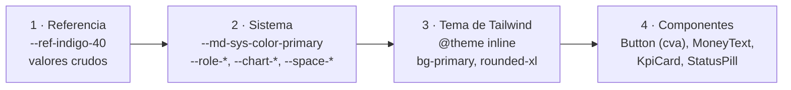

# Sistema de diseño de Alcancía

> Versión en Markdown del sitio público del sistema de diseño, en [`/#/design-system`](https://lpedaci.github.io/alcancia-app/#/design-system) (G8, D-199). El sitio muestra los componentes reales y lee los colores y los contrastes en vivo de los tokens; este archivo resume lo mismo para leerlo en el repositorio. La referencia interna de desarrollo sigue siendo `/styleguide`. La spec de origen es la sección 2 de [`CLAUDE.md`](../CLAUDE.md).

La arquitectura del sitio (índice lateral desde 1200 px, hoja de secciones en celular y tablet, secciones con muestras vivas) se tomó del sistema de diseño de Rumbo, el proyecto hermano. La identidad, los tokens y el contenido son de Alcancía.

## Índice

| Grupo | Sección | Qué muestra |
| --- | --- | --- |
| Fundamentos | [Principios](#principios) | Seis ideas que deciden cada pantalla |
| | [Arquitectura de tokens](#arquitectura-de-tokens) | Cuatro niveles y los controles automáticos |
| | [Color](#color) | Roles de M3 con contraste en vivo, superficies, colores por rol, series de gráficos y la excepción de Fuerte |
| | [Tipografía](#tipografía) | Los 13 roles de la escala de M3, con tamaño leído del navegador |
| | [Espacio y forma](#espacio-y-forma) | Espacios, radios y los tres niveles de elevación |
| | [Íconos](#íconos) | Material Symbols Rounded 300 y sus reglas |
| | [Movimiento](#movimiento) | Curvas dibujadas, duraciones y usos |
| Componentes | [Componentes](#componentes) | Botones, campos, estados y chips, KPIs, avisos, progreso y fuentes |
| | [Fuerte](#fuerte) | Seis estados y reglas de comportamiento |
| Patrones | [Patrones](#patrones) | Doce patrones con el número de su decisión |
| | [Cómo mostramos el dinero](#cómo-mostramos-el-dinero) | Formato, montos largos, crédito, campos con máscara y reglas |
| | [Seguridad y privacidad](#seguridad-y-privacidad) | Tres capas, privacidad diseñada y qué ve cada rol |
| Pautas | [Accesibilidad](#accesibilidad) | WCAG 2.2 AA en nueve criterios |
| | [Voz y tono](#voz-y-tono) | Principios y vocabulario fijo |
| | [Créditos](#créditos) | Recursos de terceros y licencias |

## Principios

1. **Aprender usando.** Quien participa entra a una billetera con dinero ficticio, no a un campus. Las secciones se abren con logros (D-50).
2. **Educación, no asesoramiento.** Escenarios con sus supuestos a la vista, nunca predicciones ni recomendaciones.
3. **Sobrio no es plano.** Sin degradés y casi sin sombras: la riqueza sale de la jerarquía, los datos, el acento y las capas.
4. **Privacidad por diseño.** Los montos viven solo en el navegador; la empresa ve aprendizaje agregado, con un mínimo de 5 personas.
5. **Para la oficina y el depósito.** La misma guía en la computadora de Mariana y en el celular de Diego.
6. **Gamificación con medida.** Sin rachas que castigan, sin rankings, sin cuentas regresivas.

## Arquitectura de tokens

Cada nivel solo usa el anterior. Controles automáticos: `tokens.test.ts` (contraste AA de cada combinación), `no-raw-values.test.ts` (ningún color, sombra ni degradé suelto en componentes) y Playwright (sin desbordes en 6 anchos y axe sin errores). Los tokens están en [`src/styles/tokens.css`](../src/styles/tokens.css); el sitio cuenta cuántos hay leyendo la hoja de estilos cargada.

## Color

| Rol | Base | Contenedor | Uso |
| --- | --- | --- | --- |
| Primario (índigo) | `#3D4FA8` | `#DEE1FA` | Acción principal, navegación activa, enlaces y foco |
| Secundario (índigo apagado) | `#55607A` | `#DCE2F2` | Botones tonales, chips de filtro |
| Terciario (verde azulado) | `#00796B` | `#CDEDE8` | Logros, metas, segunda serie |
| Error | `#B3261E` | `#F9DEDC` | Errores y acciones destructivas |
| Correcto | `#2E7D32` | `#DCEFDD` | Completado, dinero que entra |
| Atención | `#8A5300` | `#FCEBC7` | Riesgo, pendiente, pérdida de poder de compra |
| Información | `#2457C5` | `#DCE6FB` | Avisos, supuestos, respuestas para revisar |

- Los estados son solo para estados, nunca series, y siempre van con ícono y texto.
- **Colores por rol** (identifican personas, nunca estados): admin `#3D4FA8`, tutor `#00796B`, participante `#7A4FB0`, decisor `#5D6B2F`. Las cinco personas de la demo tienen foto con anillo de ese color.
- **Series de gráficos**, en este orden: primary, tertiary, índigo claro, verde azulado claro y gris, con relleno plano de baja opacidad.
- **Excepción (D-52):** el naranja de Fuerte (`--fuerte-body`, `--fuerte-light`, `--fuerte-shade`) solo en el personaje y sus luces.

## Tipografía

Inter con la escala de M3 y títulos enfatizados de M3 Expressive: `display-medium` (resultado del simulador), `display-small` (KPIs), `headline-medium` (título de página, único `h1`, D-163), `headline-small`, `title-large` (`h2`), `title-medium` (`h3`), `title-small`, `body-large` (guías), `body-medium`, `body-small`, `label-large` (botones), `label-medium` (chips) y `label-small` (contadores). Cifras tabulares en montos, porcentajes y fechas.

## Espacio y forma

- Espacios: `--space-gutter`, `--space-bento-gap`, `--space-card-padding` y `--space-section`, que crecen en tablet y escritorio. Ritmo vertical de 8 px.
- Radios: 4 px (casillas), 8 px (botones y campos), 12 px (menús), 16 px (diálogos y paneles), 24 px (tarjetas) y píldora.
- Elevación: en reposo, superficie y borde sin sombra; `--elevation-1` para menús, popovers y tooltips; `--elevation-2` para diálogos y avisos.

## Íconos

Material Symbols Rounded, peso 300, en SVG, con un componente único `<Icon name="…" />`. Contorno por defecto y relleno para lo activo. Los decorativos llevan `aria-hidden`; los botones de solo ícono, nombre accesible y tooltip.

## Movimiento

Curvas de M3 (estándar, enfatizada al entrar y al salir) y duraciones de 150, 200 y 300 ms. El resultado de un simulador cambia sin contar desde cero, las barras se llenan al entrar, las listas entran escalonadas (50 ms) y un desbloqueo aparece una sola vez. Con "reducir animaciones" solo queda la opacidad.

## Componentes

Muestras vivas en el sitio: botones (Filled, tonal, outlined, text, danger, deshabilitado con explicación y tamaños XS, S y M), campos (texto con error, `MoneyInput`, `PercentInput`), estados y chips (`StatusPill`, `MetaChips`, `SegmentedButton`), `KpiCard`, avisos (`InlineAlert` en cuatro tonos), progreso (`ProgressBar`, `SegmentedProgress`) y el pie de fuentes (`SourceList`).

## Fuerte

Seis estados (neutral, saludo, pensativo, atención, celebración y dormido) con siete luces, una por nivel completado. Habla en los momentos clave, nunca interrumpe dos veces la misma acción, no juzga ni recomienda, se puede silenciar y su mensaje se anuncia como texto (5.0.1, D-51, D-134).

## Patrones

| Decisión | Patrón |
| --- | --- |
| D-50 | La app es una billetera: guías, desafíos y herramientas dentro de sus secciones |
| 5.0 | Lo bloqueado se ve, con qué falta y progreso |
| D-164, D-72 | Navegación por tamaño: barra inferior con el nombre solo en el destino activo; menú lateral desde 1200 px; Fuerte movible |
| 2.2.1 | Anatomía del simulador |
| D-166 | Misiones declarativas en JSON |
| 2.2.1 | Retroalimentación formativa: success con explicación, info con pista |
| D-188 | Bento por cantidad de contenido |
| D-178 | El CFT antes que la cuota |
| D-182, D-187 | Fuentes al pie, en chips |
| D-195 | "Datos insuficientes" y supresión complementaria |
| D-196 | Carga por CSV en tres pasos con el error junto al campo |
| D-197 | Aviso de cambios sin guardar |

## Cómo mostramos el dinero

- Pesos `$ 1.234.567,89` y moneda extranjera con código `USD 1.200`, con espacio de no separación entre el signo y el número (D-68).
- Porcentajes siempre con período: `3 %` mensual, `42,5 %` anual.
- Dinero que entra en success y que sale en error, siempre con signo e ícono (D-170); la pérdida de poder de compra en warning, no en error.
- Montos largos: si no entran, notación abreviada (`$ 12,3 M`) con el valor completo accesible.
- Crédito: el CFT primero, junto a lo que se recibe y lo que se paga en total; "Tasa alta" en warning (D-178).
- Datos clave con tono, metadatos en chips y consecuencias en avisos de color (D-183).
- Escenarios, no promesas; supuestos a la vista; aviso legal: "Contenido educativo. No es asesoramiento financiero ni una recomendación de inversión."

## Seguridad y privacidad

| Capa | Qué incluye |
| --- | --- |
| 1 · Simulado en la interfaz | SSO neutro y rotulado, verificación en dos pasos, bloqueo tras 5 intentos, aviso de sesión por vencer, aviso de privacidad y roles desde `permissions.ts` |
| 2 · Aplicado de verdad hoy | CSP en la página verificada en la CI, sin `dangerouslySetInnerHTML`, dependencias con versión fija y auditadas, Zod y enlaces con `rel="noopener noreferrer"` |
| 3 · En producción | Encabezados HTTP reales con Cloudflare (`frame-ancestors`, HSTS, `X-Content-Type-Options`, `Referrer-Policy`, `Permissions-Policy`), protección ante bots, SSO con OIDC o SAML y permisos en el servidor (D-70) |

La privacidad también se diseña: el cartel "dinero ficticio" nunca se quita (D-69), la billetera tiene marca propia, no pide datos reales, los montos no salen del navegador y el umbral de 5 no se puede bajar.

| Rol | Avance de aprendizaje | Montos y movimientos | Hábitos de Conocerte | Si un nivel está bloqueado |
| --- | --- | --- | --- | --- |
| Participante | Todo lo suyo | Solo los suyos | Solo los suyos | Sí, lo suyo |
| Tutor o tutora | Por persona, de sus cohortes | Nunca | Nunca | Nunca (D-58) |
| Admin de L&D | Agregado, con umbral | Nunca | Nunca | Nunca |
| Decisor | Reporte agregado | Nunca | Nunca | Nunca |

Detalle en [`security.md`](security.md).

## Accesibilidad

WCAG 2.2 AA (ISO/IEC 40500:2025): formularios con etiqueta, ayuda y errores junto al campo; todo con teclado y foco visible; gráficos con frase y tabla; campos de dinero con máscara y deslizadores con campo numérico; cambios anunciados con región en vivo; alternativa a todo arrastre; sin límite de tiempo; áreas táctiles de 48 × 48 px en celular; reflujo a 320 px y zoom al 200 %.

## Voz y tono

Español latinoamericano neutro, con tú. Clara, paciente y sin juicio. Claridad primero, sin culpar, términos explicados, escenarios y no promesas, tono según el momento. Vocabulario fijo: iniciar sesión (no "loguearse"), panel (no "dashboard"), costo financiero total, poder de compra, cuotas sin interés, fondo de emergencia, meta de ahorro, tutor o tutora, desafío de nivel, celular y computadora.

## Créditos

- Contenido de finanzas: basado en la presentación del Lic. Kevin Giampieri para el taller "Del aula al primer trabajo"; las ampliaciones quedan marcadas para su revisión.
- Fuerte: personaje propio de Lourdes Pedaci, del escape room "Tu primer sueldo".
- Fotos de las personas de la demo: fotos de stock con licencia gratuita, [Designed by Magnific](https://www.magnific.com/) (D-71).
- Íconos: Material Symbols de Google, licencia Apache 2.0.
- Tipografía: Inter, de Rasmus Andersson, licencia SIL Open Font.
