# Flujos

> Fecha: 12/11/2026 · Primera tanda del paso 0. Los wireflows se dibujan a nivel de bloques; el detalle visual se resuelve en el piloto (paso 4) y se registra en `visual-audit.md`.

Este documento usa tres niveles, rotulados en cada diagrama:

- **Task flow:** el camino único de una tarea, sin variantes.
- **User flow:** el recorrido de una persona con decisiones y caminos alternativos.
- **Wireflow:** pantallas en bloques con las transiciones entre ellas.

Al final están el mapa de pantallas por rol y los diagramas de estados.

---

## 1. Acceso y primer ingreso

### 1.1 User flow · Elegir un recorrido desde la landing

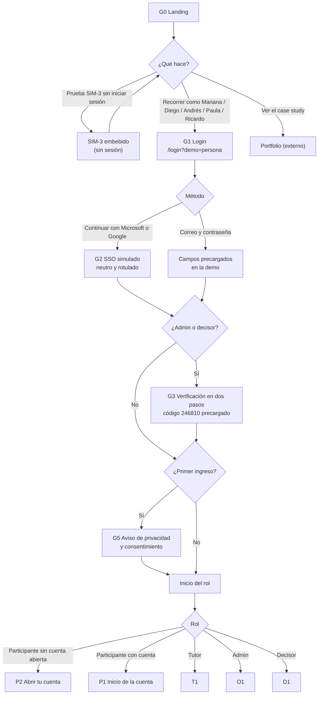

### 1.2 User flow · Errores de acceso

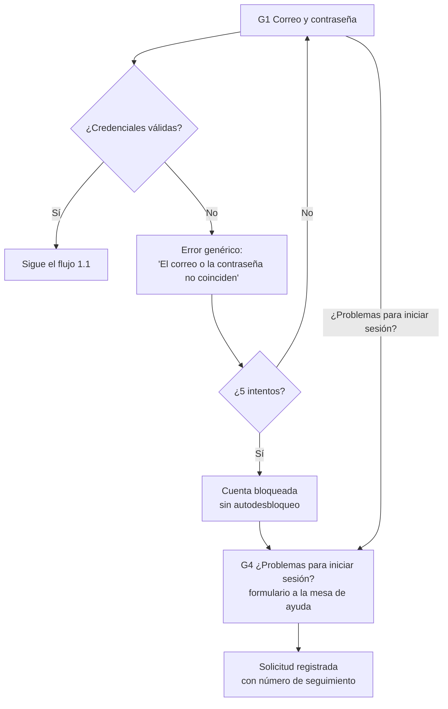

### 1.3 Task flow · Expiración de sesión

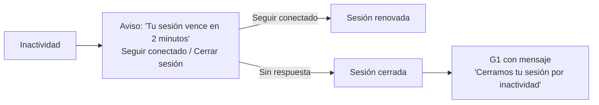

Los cambios sin guardar se protegen con `useBlocker` antes del cierre o de salir de la pantalla.

### 1.4 Task flow · "Ver como" y modo demo

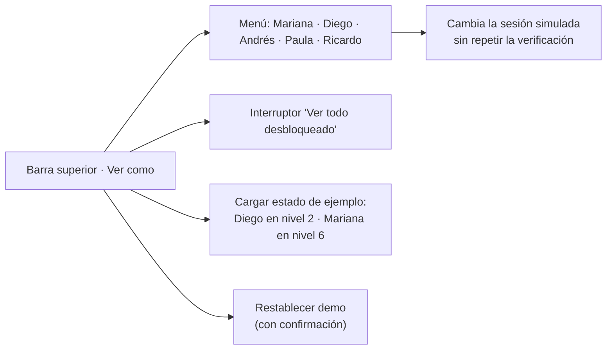

---

## 2. Participante: la billetera

### 2.1 User flow · Abrir tu cuenta (nivel 0, P2)

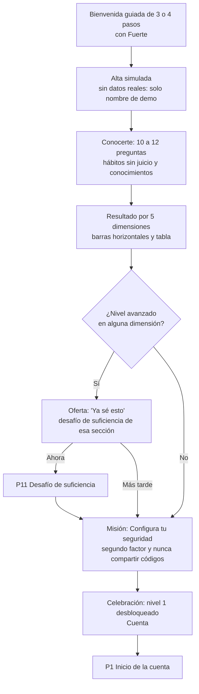

### 2.2 Wireflow · Inicio de la cuenta (P1) por tamaño

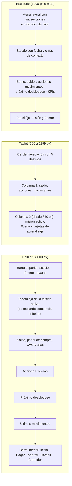

### 2.3 User flow · Una misión (motor declarativo, P12)

Ejemplo con la misión 1, "Tu primer cobro" (D-53, D-54, D-55).

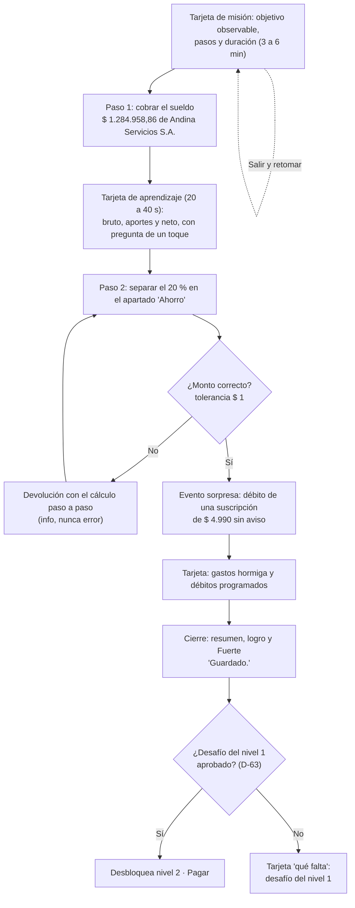

Reglas comunes del motor: los errores se permiten y tienen consecuencia en la simulación; cada error termina en una devolución con "qué pasó" y "qué hacer en la vida real"; Fuerte no interrumpe dos veces seguidas la misma acción; una tarjeta de aprendizaje ya respondida bien no se repite; cada paso registra un evento tipo xAPI.

### 2.4 User flow · Sección bloqueada y "Ya sé esto"

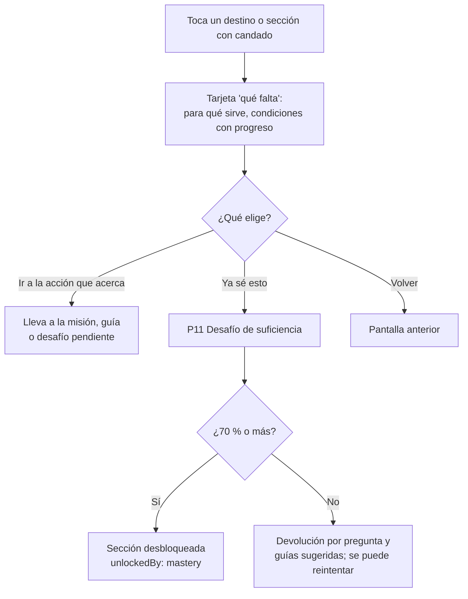

### 2.5 User flow · Desafío de nivel (D-57)

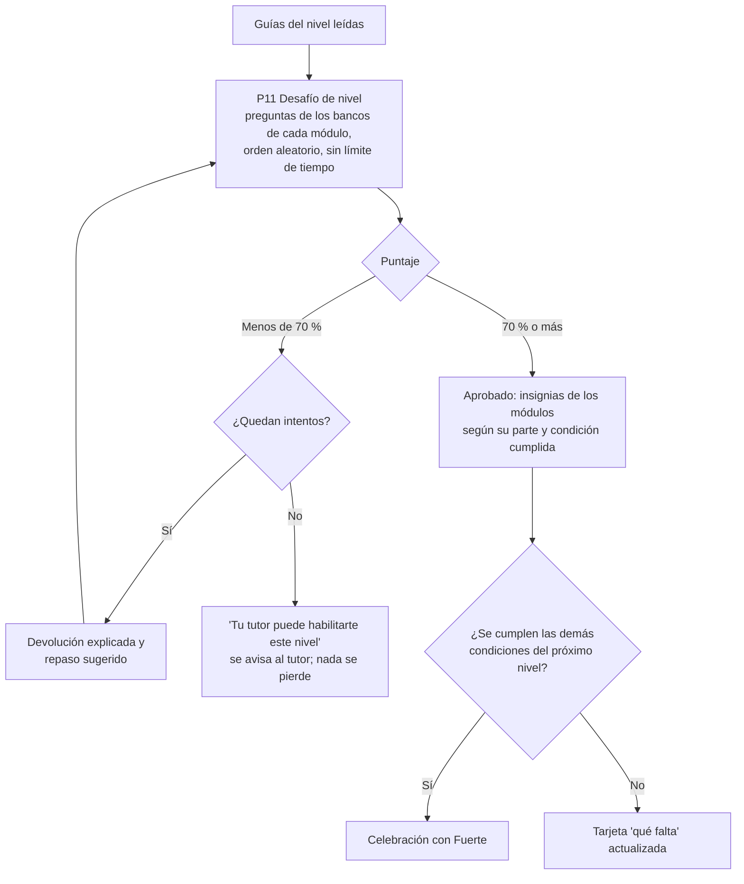

### 2.6 Task flow · Transferir sin errores (misión 2)

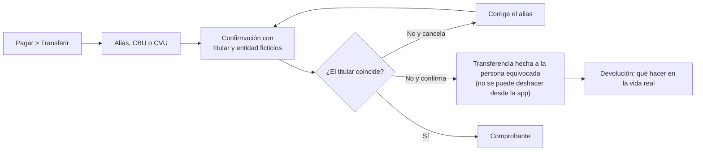

### 2.7 Task flow · Avanzar el tiempo

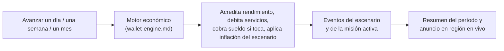

### 2.8 User flow · Guía (P10)

Sigue la secuencia de Gagné de F3, adaptada a 5 a 8 minutos: situación con números, objetivo, pregunta de recuperación, bloques breves, ejemplo resuelto, práctica (pregunta o herramienta embebida) con retroalimentación inmediata y "Para tu vida". Al terminar ofrece la misión práctica de la sección o el desafío de nivel si ya leyó todas las guías del nivel.

---

## 3. Tutor

### 3.1 User flow · Acompañar una cohorte

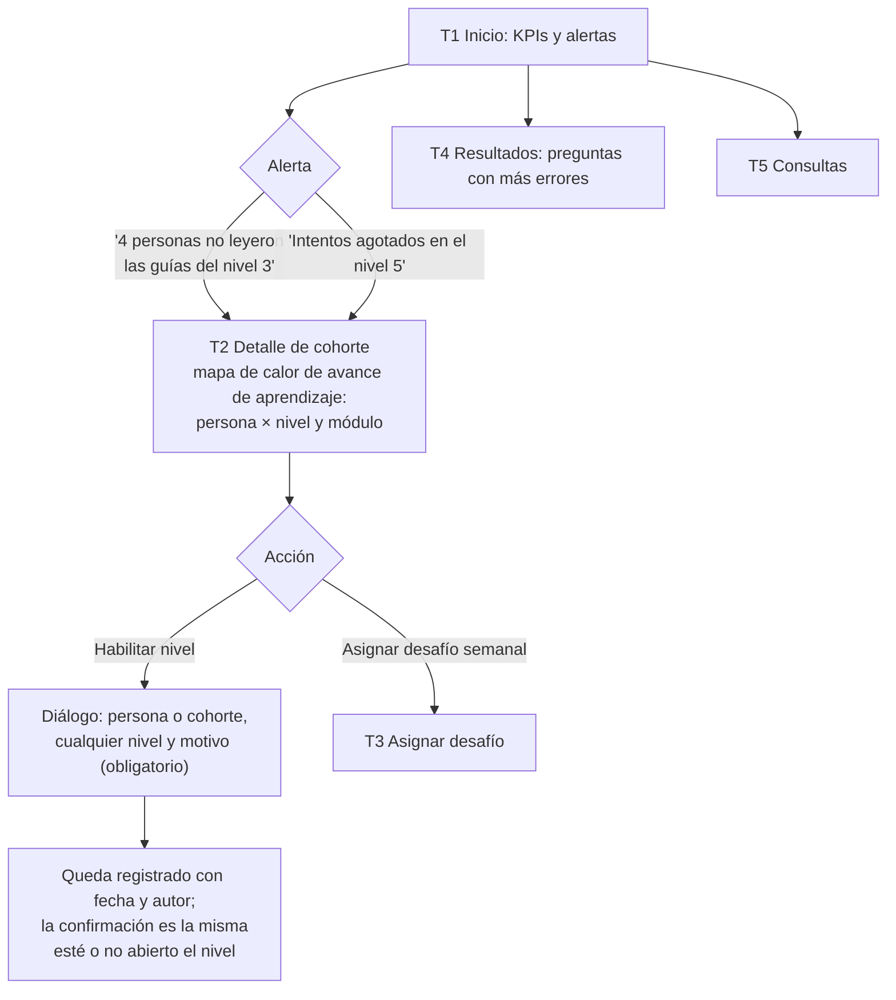

**Qué muestra cada celda del mapa de calor (D-58):** solo avance de aprendizaje. Nunca muestra si el nivel está bloqueado o desbloqueado para la persona.

| Estado de la celda | Ícono y texto | Significado |
| --- | --- | --- |
| Sin actividad | Círculo vacío · "Sin empezar" | 0 guías leídas y desafío sin empezar (puede estar bloqueado o no: el tutor no lo sabe) |
| En curso | Medio círculo · "2 de 4 guías" | Guías leídas o desafío con intentos |
| Intentos agotados | Signo de atención · "Intentos agotados" | Ofrece "Habilitar nivel" |
| Completado | Tilde · "Completado" | Guías leídas y desafío aprobado (con mejor puntaje y primero en el detalle) |
| Habilitación | Etiqueta adicional · "Por suficiencia" o "Habilitado por tutor" | Cómo se abrió, si no fue por la regla |

### 3.2 Task flow · Asignar un desafío semanal (T3)

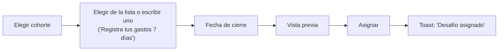

---

## 4. Admin de L&D

### 4.1 User flow · Carga masiva por CSV (O3)

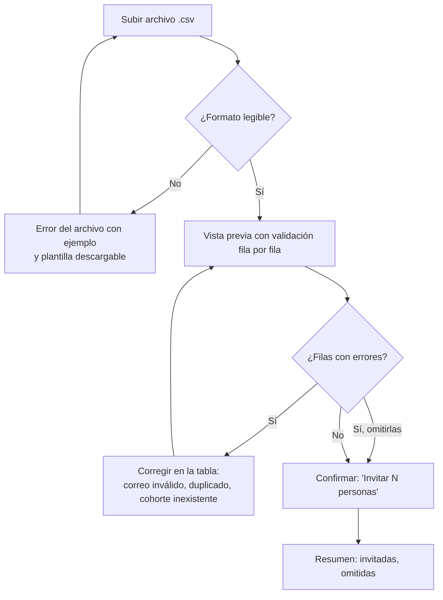

### 4.2 Task flow · Configurar el programa como asignado (O4)

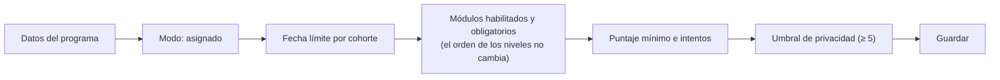

---

## 5. Decisor

### 5.1 Task flow · Consultar el reporte de impacto (D1)

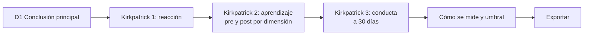

---

## 6. Mapa de pantallas por rol

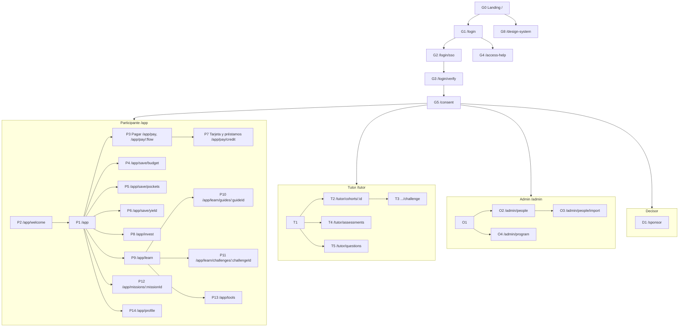

La ruta de P7 pasa a `/app/pay/credit` por D-56 (ver D-103 en `decisions.md`).

---

## 7. Diagramas de estados

### 7.1 Nivel (`LevelProgress.status`)

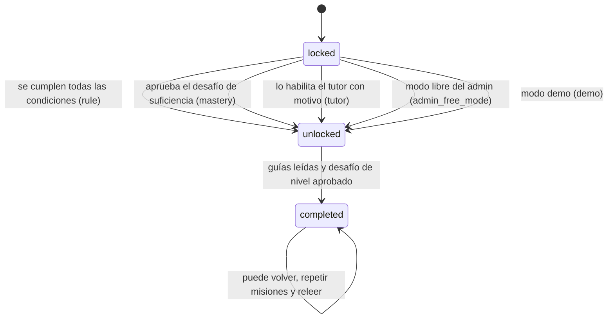

Un nivel nunca vuelve a `locked`: nada se pierde (5.0).

### 7.2 Módulo dentro de un nivel

```mermaid
stateDiagram-v2
  [*] --> no_iniciado
  no_iniciado --> en_curso: abre la guía
  en_curso --> guia_leida: termina la guía y su práctica
  guia_leida --> aprobado: su parte del desafío de nivel ≥ 70 % (insignia, D-57)
  guia_leida --> guia_leida: no alcanza; reintenta el desafío
  aprobado --> [*]
```

### 7.3 Misión

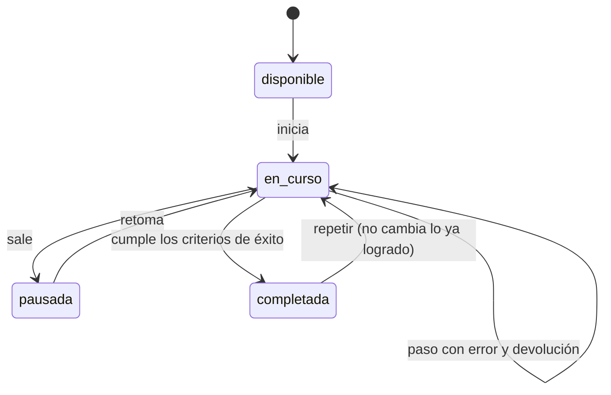

### 7.4 Desafío semanal (por persona)

```mermaid
stateDiagram-v2
  [*] --> asignado
  asignado --> reportado: autoinforme (cumplido, parcial o no)
  asignado --> vencido: pasa la fecha sin informe
  vencido --> reportado: informe tardío (permitido)
  reportado --> [*]
```

### 7.5 Persona en la organización

```mermaid
stateDiagram-v2
  [*] --> invited: alta individual o CSV
  invited --> active: primer inicio de sesión y consentimiento
  active --> inactive: baja por el admin
  inactive --> active: reactivación
  invited --> inactive: baja antes de ingresar
```
