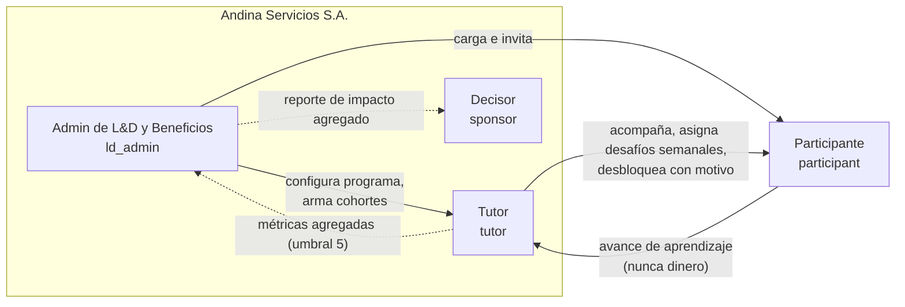

# Roles y permisos

> Fecha: 12/11/2026 · Fuente de verdad en código: `src/lib/permissions.ts` (se crea en el paso 3). Esta matriz es la especificación de ese archivo; si cambia uno, se actualiza el otro en el mismo commit.

Alcancía sigue el principio de **mínimo privilegio** y de **privacidad por diseño** (spec 1, 4.2 y 8): cada rol ve lo que necesita para su tarea y nada más. La separación más importante es entre **aprendizaje** (lo que la empresa puede ver, a veces de forma individual) y **dinero** (lo que nunca sale del navegador de la persona).

## 1. Roles del MVP

| Rol (código) | Persona de demo | Color de rol | Para qué entra |
| --- | --- | --- | --- |
| `ld_admin` | Paula Gómez, Líder de Aprendizaje y Beneficios | `role-org-admin` `#3D4FA8` | Configurar el programa, cargar personas, armar cohortes, seguir la adopción |
| `tutor` | Andrés Molina, tutor de bienestar financiero | `role-tutor` `#00796B` | Acompañar cohortes, asignar desafíos semanales, reforzar temas, desbloquear con motivo |
| `participant` | Mariana López (oficina) y Diego Suárez (operativo, celular) | `role-participant` `#7A4FB0` | Usar la billetera de práctica y aprender en ella |
| `sponsor` | Ricardo Benítez, Gerente de Compensaciones | `role-sponsor` `#5D6B2F` | Leer el reporte de impacto agregado |

Las cuentas son de trabajo: no hay autogestión de acceso, los problemas se derivan a la mesa de ayuda de la empresa (G4). No existe un rol de sistemas en el MVP.

## 2. Qué dato vive dónde

| Tipo de dato | Dónde vive | Quién lo ve |
| --- | --- | --- |
| **Dinero de la billetera** (saldo, movimientos, apartados, metas, decisiones en misiones, tenencia de la cuenta comitente) | `walletStore`, en `localStorage`, en un espacio separado por persona | Solo la persona, en su navegador |
| **Datos de herramientas** (`LocalScenario`, `LocalGoal`) | `localStorage`, espacio separado por persona | Solo la persona |
| **Respuestas de hábitos** de "Conocerte" | Navegador de la persona | Solo la persona. Agregadas por dimensión y con umbral, para L&D y el decisor (Kirkpatrick 2) |
| **Respuestas de conocimiento** de "Conocerte" y puntajes de desafíos de nivel | Datos de aprendizaje | Persona; tutor de forma individual; admin y decisor agregados |
| **Estado de cada nivel** (bloqueado, en curso, completado) y cómo se desbloqueó | Datos de aprendizaje | Persona; tutor de forma individual **sin el motivo de un bloqueo de la billetera** (D-58); admin agregado |
| **Misiones** (completadas, intentos, aciertos) | Datos de aprendizaje | Persona; tutor y admin **solo agregado por cohorte**, con umbral de 5 (5.3) |
| **Desafíos semanales** (cumplido, parcial, no) | Datos de aprendizaje | Persona; tutor individual; admin agregado. La **reflexión** opcional solo la ve la persona |
| **Satisfacción y seguimiento a 30 días** | Datos de aprendizaje | Persona; admin y decisor agregados |
| **Consultas al tutor** | Datos de aprendizaje | Persona y su tutor |

Regla de implementación: ninguna vista de tutor, admin o decisor importa ni lee `walletStore`, `LocalScenario` ni `LocalGoal`. Un test lo verifica (criterio de aceptación de la sección 11).

### 2.1 Cómo se respeta D-58 en el mapa del tutor

El estado de un nivel puede depender de una condición de la billetera (`wallet_metric`), por ejemplo "fondo de emergencia de al menos 3 meses" para Invertir. El tutor ve:

| Lo que pasa en la billetera | Lo que ve la persona | Lo que ve el tutor |
| --- | --- | --- |
| Invertir bloqueado por fondo de 2 de 3 meses | "Fondo de emergencia: 2 de 3 meses" con barra | "Nivel 7 · Bloqueado" |
| Invertir bloqueado porque falta el desafío del nivel 6 | "Te falta: desafío del nivel 6" | "Nivel 7 · Bloqueado · Desafío del nivel 6 pendiente" (es aprendizaje) |
| Nivel desbloqueado por suficiencia | "Desbloqueado con 'Ya sé esto'" | "Nivel 3 · En curso · por suficiencia" |
| Nivel desbloqueado por el tutor | "Te lo habilitó tu tutor" | "Nivel 5 · En curso · habilitado por Andrés Molina: [motivo]" |

Cuando un nivel tiene condiciones de los dos tipos, el tutor solo ve las de aprendizaje. Si la única condición pendiente es de la billetera, ve "Bloqueado" sin más detalle.

## 3. Matriz de permisos

Leyenda: ✔ permitido · ◐ solo agregado con umbral de privacidad (mínimo 5) · ✖ no permitido. "Propio" significa los datos de la misma persona.

### 3.1 Billetera y aprendizaje del participante

| Permiso (`permissions.ts`) | Participante | Tutor | Admin | Decisor |
| --- | --- | --- | --- | --- |
| `wallet.use` (usar la billetera, misiones, herramientas) | ✔ propio | ✖ | ✖ | ✖ |
| `wallet.read` (saldos, movimientos, apartados, metas) | ✔ propio | ✖ | ✖ | ✖ |
| `learning.take` (guías, desafíos de nivel, "Conocerte") | ✔ propio | ✖ | ✖ | ✖ |
| `learning.readIndividual` (avance por persona y módulo, puntajes de desafíos de nivel, estado de niveles sin motivo de billetera) | ✔ propio | ✔ sus cohortes | ✖ | ✖ |
| `learning.readAggregate` | ✖ | ◐ sus cohortes | ◐ toda la organización | ◐ toda la organización |
| `missions.readAggregate` (completadas, intentos, aciertos) | ✖ | ◐ sus cohortes | ◐ | ✖ |
| `diagnostic.readHabits` (respuestas de hábitos) | ✔ propio | ✖ | ◐ por dimensión | ◐ por dimensión |
| `levels.unlockForPerson` / `levels.unlockForCohort` (con motivo) | ✖ | ✔ sus cohortes | ✖ | ✖ |
| `program.freeMode` (todo desbloqueado) | ✖ | ✖ | ✔ | ✖ |

### 3.2 Tutoría

| Permiso | Participante | Tutor | Admin | Decisor |
| --- | --- | --- | --- | --- |
| `weeklyChallenge.assign` | ✖ | ✔ sus cohortes | ✖ | ✖ |
| `weeklyChallenge.report` (cumplido, parcial, no y reflexión) | ✔ propio | ✖ | ✖ | ✖ |
| `weeklyChallenge.readResults` | ✔ propio | ✔ resultado, sin reflexión | ◐ | ✖ |
| `questions.ask` (consultas) | ✔ | ✖ | ✖ | ✖ |
| `questions.answer` | ✖ | ✔ sus cohortes | ✖ | ✖ |
| `assessments.readItemStats` (preguntas con más errores) | ✖ | ◐ sus cohortes | ◐ | ✖ |

### 3.3 Organización e impacto

| Permiso | Participante | Tutor | Admin | Decisor |
| --- | --- | --- | --- | --- |
| `program.configure` (F1) | ✖ | ✖ | ✔ | ✖ |
| `people.manage` (alta, CSV, estados) | ✖ | ✖ | ✔ | ✖ |
| `cohorts.manage` | ✖ | ✖ | ✔ | ✖ |
| `cohorts.read` | ✔ la propia | ✔ las suyas | ✔ todas | ✖ |
| `adoption.read` (O1) | ✖ | ✖ | ◐ | ◐ |
| `impact.read` (D1) | ✖ | ✖ | ◐ | ◐ |
| `impact.export` | ✖ | ✖ | ✔ | ✔ |
| `privacyThreshold.edit` (mínimo 5, no se puede bajar) | ✖ | ✖ | ✔ solo hacia arriba | ✖ |

### 3.4 Rutas por rol

| Prefijo de ruta | Participante | Tutor | Admin | Decisor |
| --- | --- | --- | --- | --- |
| `/app/*` | ✔ | ✖ | ✖ | ✖ |
| `/tutor/*` | ✖ | ✔ | ✖ | ✖ |
| `/admin/*` | ✖ | ✖ | ✔ | ✖ |
| `/sponsor` | ✖ | ✖ | ✖ | ✔ |
| `/`, `/login/*`, `/access-help`, `/consent`, `/design-system` | ✔ | ✔ | ✔ | ✔ |

Una ruta ajena muestra "Acceso no permitido" (G7), con un enlace al inicio del rol actual. El selector "Ver como" no es un permiso: es una herramienta de la demo que cambia la sesión simulada (sin repetir la verificación en dos pasos, F0).

## 4. Autenticación por rol (simulada)

| Rol | SSO (Microsoft o Google) | Correo y contraseña | Verificación en dos pasos |
| --- | --- | --- | --- |
| Participante | ✔ | ✔ | Opcional (se configura en la misión "Configura tu seguridad") |
| Tutor | ✔ | ✔ | Opcional |
| Admin | ✔ | ✔ | **Obligatoria** |
| Decisor | ✔ | ✔ | **Obligatoria** |

Comunes: error de credenciales genérico, bloqueo tras 5 intentos sin autodesbloqueo, expiración por inactividad con aviso previo, consentimiento al primer ingreso (G5). La segunda verificación de la billetera (nivel 0) es parte de la práctica, no del acceso a la plataforma.

## 5. Umbral de privacidad

- Toda métrica agregada pasa por `aggregate()` en `src/lib/metrics.ts`.
- Si el grupo tiene menos de `privacyThreshold` personas (mínimo 5), se muestra "Datos insuficientes para mostrar este grupo sin identificar a nadie" y no se muestra ningún número parcial que permita deducirlo (por ejemplo, un total del que se pueda restar).
- La semilla incluye una cohorte con menos de 5 personas para mostrarlo.

## 6. Tests que protegen esta matriz

| Test | Qué verifica |
| --- | --- |
| `permissions.test.ts` | Cada permiso de las tablas 3.1 a 3.3 para cada rol |
| `metrics.test.ts` | Umbral: 4 personas devuelve "datos insuficientes"; 5 devuelve el valor |
| `privacy-boundaries.test.ts` | Ningún módulo de `features/tutor`, `features/organization` ni `features/sponsor` importa `walletStore` ni lee las claves locales de la persona |
| `tutor-level-status.test.ts` | La vista del tutor nunca recibe condiciones `wallet_metric` ni su progreso (D-58) |
| E2E de rutas | Cada rol recibe "Acceso no permitido" en los prefijos ajenos |
